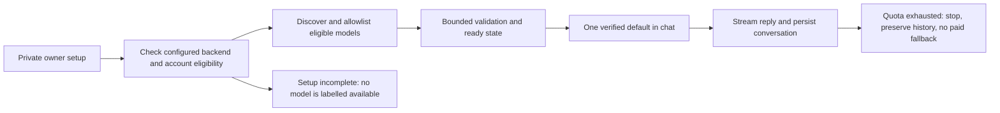

# Model access and first-run readiness

Decision recorded 8 November 2026 from owner feedback. This is the required
behavior. The initial direct Groq/readiness implementation is now in security
PR #1 at `2239214`; this documentation PR adds no runtime changes. Both candidate
models returned nonempty synthetic greetings during the protected Vercel build.
Real owner streaming, persistence and Phase 0 acceptance remain pending. See
[free-chat-readiness.md](free-chat-readiness.md) for the implementation and limits.

## Product requirement

The assistant must be configured before normal chat use. A model labelled
"Available" must be usable by this account through the configured backend, not
merely present in a vendor catalogue. Prefer verified free-tier inference. The
owner should receive one clear general-chat default; other verified choices may
be placed under an optional advanced picker. Unsupported/unconfigured or
unapproved paid models are hidden from normal chat selection.

Do not open provider activation or payment dialogs during an ordinary chat turn.
One-time account/key configuration, if necessary, belongs in a separate owner
setup flow with a clear ready/not-ready result. The chat should preserve any
unsent input and explain that setup is incomplete if no model is usable.

"Free" describes the hosting account's plan and current quota, not model weights
or an advertised catalogue price. An open model is not automatically free to run;
free credits are not unlimited access. Premium models must not be advertised as
free. Exhausted free quota should produce a temporary-unavailable state, not an
automatic upgrade, purchased credit, different unapproved backend or paid fallback.

## Current implementation

- Exact Groq candidates GPT OSS 20B and 120B are build-verified with the same
  AI SDK Chat Completions adapter as chat, using bounded synthetic greetings.
- Everyday chat is preferred; Detailed chat is optional. Only successful,
  server-allowlisted models appear. The endpoint is owner-only and checks current
  credentials/catalogue again; catalogue visibility alone never enables a model.
- No Gateway activation dialog, premium fallback catalogue or separate paid title
  call remains. Titles are local. Missing setup disables send and preserves input;
  failed sends restore text; provider errors disclose no raw details.
- Key scope is only the protected security Preview. No key was read or committed.
  No package or schema was added. Existing owner, storage and integration barriers
  remain. There is no automatic paid/provider fallback.

The previous static catalogue and payment dialog are historical findings, now
corrected on the feature branch. Account plan/retention evidence remains
owner-supplied, and no quality, tool-use or real iPhone benchmark is claimed.

## Verified provider information and remaining choices

| Path | Evidence checked on 8 November 2026 | Tradeoff and decision |
| --- | --- | --- |
| Existing Vercel AI Gateway | Official getting-started docs require a payment method even for free credits; pricing says free credits cover a subset of models. | Preserves current routing, but cannot satisfy a no-card path. Do not ask the owner to activate it from chat or silently buy credits. Keep optional use subject to an explicit cost decision. |
| Direct Groq free tier | Official billing FAQs distinguish Free and paid Developer tiers; a payment method is required for the paid upgrade. Rate-limit docs specify 429 on exhaustion. | Strong candidate for an initial quota-limited free text backend. Confirm the actual account's Free status, setup/card requirements, available models and quota before promising it works without a card. The owner saved the private key; both candidates passed live synthetic inference. Account quotas can still expire. |
| Direct Gemini free tier | Official pricing lists free access for selected models and free-tier content-improvement terms. | Another candidate, but model/region availability, exact account terms and data use require review. Do not select it for personal mail based on price alone. |

Groq's data documentation says inference content is not retained by default, with
reliability/abuse exceptions up to 30 days, configurable Zero Data Retention,
always-retained usage metadata and US storage. Those distinctions still require
owner review before sensitive integration data is sent. Gemini's exact regional
terms likewise need review; a pricing-page summary is not a universal privacy
conclusion. No provider has been approved for Gmail by this comparison.

English/Turkish quality, tool calling, streamed output and SDK compatibility have
not been benchmarked here. Do not choose a model ID or add a provider dependency
from memory. Discover models with the configured account and verify support for
the existing AI SDK 6.0.116 when evaluating future changes. Credentials remain private in Vercel; no secret should be sent in chat.

## Implementation acceptance criteria

The initial correction is part of draft security PR #1. Complete real-owner
acceptance of text chat before
returning to the rich-answer roadmap. Use the same Vercel/Neon/Auth.js application,
not a second backend or a persistent VM.

- Prefer the simplest compatible direct-provider adapter if it avoids mandatory
  gateway payment verification; retain the current SDK and message storage.
  Implement only one approved backend initially. Do not build a generic routing
  platform or migrate working identity/database code.
- Keep credentials server-only. Account/key setup and any terms decision happen
  once outside normal conversation. No payment method, purchased credits or
  paid integrations may be added without explicit authorization.
- Server readiness combines valid credentials, supported model IDs/capabilities,
  account eligibility and a bounded successful test. A positive API catalogue
  response alone is insufficient. Do not probe with a model call on every render.
- A provider may not expose all plan/quota details by API. In that case document
  the verified account setting and evidence freshness; do not manufacture a
  guarantee from a variable called "free" or a successful credential check.
- Show only verified server-allowlisted choices, with a clear default and honest
  quota status. A forged client model ID cannot select an unapproved paid model.
  Unconfigured/loading/error states must not fall back to the static premium list.
- All generation paths must follow the same policy: chat, title generation and
  document tools. Prefer a local deterministic title where appropriate so a
  separate paid title model cannot block otherwise free chat.
- Preserve model provenance in the conversation and be explicit about model
  changes. Do not silently change the model during a privileged approval flow.
- Handle quota expiry with bounded retries and readable status. Preserve unsent
  input and saved conversations. Never automatically reroute to a paid provider.

Acceptance: free-account readiness verified, one real bilingual streamed reply,
refresh persistence, selection restricted on the server, no activation popup,
quota/credential failures handled, five existing security tests plus six readiness cases retained, and
relevant TypeScript/lint/build/targeted UI tests pass. Actual iPhone validation
remains required. The implementation is preview-only; no production release is approved.

## Official sources

- https://vercel.com/docs/ai-gateway/getting-started
- https://vercel.com/docs/ai-gateway/pricing
- https://console.groq.com/docs/billing-faqs
- https://console.groq.com/docs/rate-limits
- https://console.groq.com/docs/your-data
- https://ai.google.dev/gemini-api/docs/pricing
