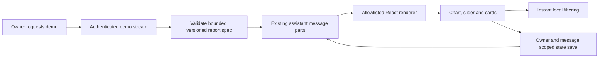

# Smallest next implementation — one durable interactive answer

Status: proposal, not implemented. Read [CURRENT_STATE.md](CURRENT_STATE.md) first.
Phase 0 acceptance and a focused Phase 1 task must precede implementation.

## Phase 0 blocker before this proposal

The first real chat attempt is blocked by AI Gateway payment verification. The
owner requires usable models, preferably free, to be configured before normal
chat—not activation prompts or an unverified catalogue. The smallest next coding
task is therefore the focused text-chat readiness proposal in
[MODEL_ACCESS.md](MODEL_ACCESS.md). No rich UI implementation begins until that
blocker and Phase 0 acceptance are resolved.

## Immediate next action: close the security gate

Use the protected security preview on the owner's iPhone. Complete Google login,
send a short bilingual message, verify an available model streams a reply, reload
and reopen the same conversation, then change to another available model and
verify that selection is used. Check signed-out denial separately. Record actual
results and any errors in CURRENT_STATE.md. A READY build is insufficient evidence
for the OAuth callback, Neon identity mapping or message persistence.

Review PR #1, including its remaining low development-only dependency advisory.
Any merge or production release remains a separate explicit owner decision.
Acceptance does not itself authorize either action.

## First Phase 1 PR: fictional inbox priority report in chat

The owner asks for a sample inbox report and receives one assistant message with
short prose, a priority chart, a labelled threshold slider and matching thread
cards. A clear "Fictional demo data" label stays visible. Moving the slider updates
the chart and cards instantly, without a model call. Reloading or opening the
conversation on another signed-in device restores the same report and selection.
Text and a simple table remain usable when the richer renderer cannot load.

This is one complete interaction in the current chat, not a second assistant or
a dashboard detached from conversation storage. Use a fixed small dataset and a
deterministic streamed fixture first. This tests the UI and storage boundaries
without Gmail permission, variable model output or new inference expense.

## Contract and boundaries

- Keep one schema version, a bounded data shape, stable item IDs, a source label,
  and an explicit selection state. Reject unknown components and oversized or
  malformed input. Nothing in the spec is executable JavaScript, HTML, a URL to
  fetch automatically, or authorization for an external action.
- Save the completed spec and small selection state with the existing message
  parts if the chosen renderer supports that representation. The current JSON
  column makes this plausible; verify serializer and SDK compatibility before
  assuming a migration is unnecessary. Preserve ordinary text/tool parts.
- Validate ownership of both chat and message on state writes. Accept only the
  specific selection field for this report, never arbitrary message replacement
  or a client-provided user ID. Debounce state saves; resolve overlapping updates
  with an explicit revision/conflict policy. Save status should be visible.
- Only complete, validated UI units should become interactive during streaming.
  Broken or interrupted streams need a text fallback and must not create an
  actionable half-report. Demo controls have no email or background-task actions.
- Slider changes filter existing data locally. Neither filtering nor saving its
  state should invoke a model. Keep source data and model/tool text untrusted.

## Reuse decision inside that bounded PR

| Approach | Benefit | Tradeoff / selection test |
| --- | --- | --- |
| Open Intelligent UI official AI SDK adapter | Potential reuse of streaming and interactive answer plumbing | Verify exact package, licence, AI SDK 6.0.116 peer compatibility, serialized state and mobile behavior before selecting it. |
| Vercel json-render with an allowlisted catalogue | Declarative boundary aligns with validation and trusted React components | Verify its current streaming and persistence contracts; avoid building a parallel conversation store. |
| One hand-authored report component behind the same schema | Small fallback if neither adapter fits without a framework upgrade | Less renderer reuse; keep the contract narrow so replacement remains possible. |

Prefer whichever existing option demonstrates this exact interaction with the
fewest new dependencies and no AI SDK major upgrade. No library winner is claimed
in this documentation task: current adapter versions/APIs have not been
researched or tested here. Avoid a speculative generic component catalogue.

## Acceptance for the first implementation PR

1. A streamed fictional report appears as a message in the existing owner chat.
2. Chart, slider and cards agree; filtering needs no network/model round trip.
3. Reload and a second signed-in device restore the spec and chosen threshold.
4. Owner checks run before data access and state writes. Another account, forged
   spec, unsupported component and invalid patch are denied without side effects.
5. iPhone Safari checks cover touch target size, horizontal overflow, keyboard and
   screen-reader labels, interruption during streaming, and text fallback. Desktop
   emulation can assist development but does not establish a real Safari pass.
6. Existing text conversations and model selection still work; targeted tests,
   TypeScript, lint and build pass. Credentials, production settings, Gmail,
   schedules and voice remain outside this PR.

## Why this order

This is the smallest step that tests the central product promise: useful,
interactive answers that remain part of the conversation. A static chart-only
page would not establish that contract. Combining Gmail, voice and rendering in
one release would make failures harder to locate and introduce consent and usage
costs before the basic interaction is trustworthy.

Voice remains the next major capability after the report slice, with an explicit
English/Turkish and iPhone interruption benchmark. Google identity never becomes
Gmail authorization implicitly. Gmail send, recurring execution and sandbox work
retain their own later acceptance and approval gates.
